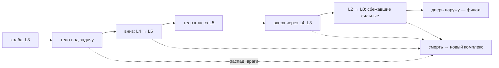

# Игровой цикл — от и до

Геймдизайн, черновик **15.10**. Сводит в одну картину решения сессии E (01.10) и
решения пользователя 15.10: эвакуации нет; душа прокачивается RPG-путём —
рангами и условиями; очки души — за поглощение сознаний; тело — билд, который
выбирают под контекст комнаты; L5 — за мощным телом. Это итоговый вид игры, от
которого составляется план. Числа — ориентиры порядка величин: считать их
будет скилл `game-balance` после прототипа.

Опирается на [[Две оси прогрессии — тело и лабиринт]], [[Угроза — зачем выбираться
из комплекса]], [[Источники эссенции]], [[Экран победы]], [[Артефакт «Архитектор»]]
и лор [[История]]. Где карточка пересматривает прежнее решение, это сказано
прямо, со ссылкой.

---

## 1. Игра в одном абзаце

Игрок — БФЖ: сознание без тела, рождённое в колбе на L3 исследовательского
комплекса. Комплекс — лабиринт, который перекраивает повреждённый артефакт
«Архитектор». Вне тела душа быстро распадается, поэтому выживает она захватом
тел. **Цель игры одна — выбраться на поверхность (L0).** Первый побег — финал:
БФЖ вырывается наружу и поглощает всё живое. **У забега два конца — смерть или
побег**; эвакуации нет (решение 15.10). Каждый забег — попытка побега, и
смерть — его обычный конец, как в Hades.

Прогрессия — **три слоя**:

| Слой | Что это | Чем растёт | Живёт |
|---|---|---|---|
| **Душа** — RPG | Навыки души: ранги и условия | Очки души за поглощение сознаний; выполненные условия (§4.1) | Всю игру |
| **Тело** — билд | Вид тела: его способности, оружие, артефакт | Выбор тела под контекст комнаты (§4.2) | Пока тело носится |
| **Лабиринт** | Калибровка Архитектора | Эссенция за изучение (§4.3) | Всю игру |

Душа делает игрока сильнее в любом теле. Тело решает, **как** он играет здесь и
сейчас: «через копьё», «через когти», «через винтовку». Лабиринт решает, как
трудно найти дорогу. Выход не заперт ничем, кроме баланса.

## 2. Слои L0–L5

**Слоёв шесть: L0 — поверхность, L5 — дно.** Сейчас генератор строит пять
(`RS_LevelGraph.DEPTHS = [4, 3, 2, 1, 0]`), и L5 надо добавить (§10, П0). Номер
слоя — потолок угрозы для тех, кто остался на месте ([[Угроза — зачем выбираться
из комплекса]], «Шкала угроз»).

| Слой | Что это | Кто там | Зачем туда игроку |
|---|---|---|---|
| **L0** | Поверхность: проходная, КПП, гараж, двор. Свой набор комнат — [[Слой L0 — поверхность]] | Люди (L0–L1) и сбежавшие наверх существа класса L5 | Выход (`exit_room`, две на забег) — финал |
| **L1–L2** | Офисы, лаборатории, склады | Учёные, охрана, скауты | Путь наверх, находки |
| **L3** | Колба (хаб, старт) и Архитектор — на другом этаже слоя | Военные частной армии | Старт каждого забега |
| **L4** | Полигон, содержание существ и артефактов | Военные с оружием, существа | Тела сильнее, враждебные артефакты, осколки |
| **L5** | Дно у разлома | Существа и артефакты Кавума класса L5 — те, что остались | **Мощное тело** класса L5 |

**Зачем L5 (решение 15.10).** Часть существ L5 ушла наверх, часть осталась на
дне. Сбежавших можно встретить ближе к поверхности, а **L5 уничтожает только
другой L5** — поэтому, чтобы пройти их у выхода, нужно тело с самого дна.

## 3. Форма забега

Классическая схема забега (решение 15.10): **найти тело, чтобы спуститься ниже;
спуститься; забрать мощное тело; пройти уже пройденное и драться с противниками
сильнее — и сбежать.** Глубину каждому забегу дают хаос генератора и то, как
улучшения Архитектора этот хаос упорядочивают.

Внутри забега главное решение повторяется в каждой комнате: **какое тело нужно
здесь** и на что потратить запас жизни — драться за тело или обойти, лезть в
тупик за находкой или к лестнице. В ранней игре таймер — распад души; к тому
моменту, когда игрок овладевает телом L5, распад давить уже не должен (ветка
«Выживание», решение 01.10), и давят враги.

## 4. Прокачка

### 4.1 Душа — RPG: ранги и условия

Правило пользователя 15.10: **делаешь действия — за это прокачиваешься**, без
очков за прохождение лабиринта.

**Навык** — несколько рангов, у каждого своё значение, и отдельное поле —
**бонус за выполнение условия**. У каждого ранга своё условие; выполнено —
значение ранга растёт на этот бонус. Пример пользователя — «Скорость», три
ранга 10 / 12 / 15, бонус за условие 20 %:

| Ранг | Без условия | С условием |
|---|---|---|
| 1 | +10 | +12 |
| 2 | +12 | +14.4 |
| 3 | +15 | +18 |

Формула: **бонус = значение ранга r × (1 + бонус условия, если условие ранга r
выполнено)**. Множитель не копится от ранга к рангу — экспоненциального роста
нет. Ранг покупается очком души; условие выполняется действием (пример — «пробежать
1 км» на первом ранге, «2 км» на втором).

Как это ложится на код: механика уже читает вычисленный стат «база автора плюс
модификаторы души» (`C_StatModifiers`, [[Модификаторы механик через скиллы]]), а
не сырое поле, — база тела не перезаписывается, и правило проекта держится.
Меняется описание навыка: сейчас модификатор линейный (`per_rank`), а здесь —
**значение на каждый ранг** плюс поле бонуса и условие на ранг. Прогресс условий
копится между забегами: учится душа, а не тело.

**Условия считаются в контексте** (решение 15.10, пометка — не забыть). Урок
Elder Scrolls: «пробежать 1 км» выполнят, бегая кругами в колбе, — как прыжки
ради Акробатики. Дистанция — только по клеткам, новым в этом забеге, или под
угрозой; «убить N» — только врагов не слабее своего класса. Лучше подвиги
(«уйти от погони военного»), чем голые счётчики.

**Навыки способностей** (идея пользователя 15.10). Часть навыков прокачивает
определённую способность тела — «Скорость» первая такая. Они работают, только
когда у тела эта способность есть: способность — компонент тела, и в безногом
теле «Скорость» честно гаснет, а дерево и HUD это показывают
([[Захват тела]]: «способность — компонент, каждая — своя система»).

**Очки души — за поглощение сознаний** (решение 15.10). По лору захват
поглощает не только тело, но и сознание ([[История]], «Природа Бифижа»):

| Что | Очки души |
|---|---|
| Захват тела | По классу тела: L0 — меньше всех, L5 — больше всех |
| Первый захват вида в забеге | ×2 |
| Повторный захват того же вида в забеге | ×0.5, ×0.25, дальше 0 |
| Тело выжато до конца — сознание усвоено целиком | Бонус; это уже есть — «Чистый выход» (`O_ExpelFromBody`) |

Это действие, а не прохождение; оно в центре игры; и оно само тянет вниз —
сознание L5 стоит больше всех. **Шкала растёт, как у эссенции, но не так
сильно** (решение 15.10): эссенция — тысячи, очки души — десятки и сотни.
**Награду за глубину это заменяет** (решение 15.10): сейчас очки за забег —
`RunManager._max_depth_reached` в `die()` и `finish_run()`, и она росла за спуск
вниз, прочь от выхода.

### 4.2 Тело — билд под контекст

Тело — аналог билда: вид определяет набор способностей (атака копьём,
когтями, оружие — решения 01.10: оружие и артефакт остаются с телом,
человеческое оружие работает в человеческом теле). **Выбор тела — выбор
способностей под контекст** (решение 15.10): у разных комнат разный контекст, и
он требует разных тел — безногое не прыгает, в вентиляцию пролезет мелкое,
угрозу класса L5 убивает только тело L5. Поэтому менять тело посреди забега
нужно, а не только приходится, когда старое сгнило или погибло.

**Идея, принята 15.10: отголоски поглощённых.** По лору после захвата БФЖ
какое-то время думает так, как думал поглощённый. Каждое поглощённое сознание
даёт до конца забега **отголосок** — малую черту: солдат — выучку обращения с
оружием, учёный — чтение терминалов, существо — живучесть плоти. Отголоски
переживают смену тела и сгорают со смертью. Так у забега есть своя сборка, как
дары в Hades: цепочка тел, через которую игрок прошёл. Какие черты и сколько —
открыто ([[Обдумать]]).

### 4.3 Лабиринт — эссенция за изучение

Правило пользователя 15.10: изучение лабиринта приносит только эссенцию.
Масштаб — тысячи (решение 01.10): первое улучшение стоит ~1000, хороший забег
даёт 1–3 тысячи.

| Источник | Что фиксирует код | Порядок |
|---|---|---|
| **Находка** — артефакт в комнате | Подбор интеракцией; **сделано 15.10** (`LayerFinds`) | 100–300 |
| **Тайник** в тупике | То же, место — тупик плана; **сделано 15.10** | 200–400 |
| **Секрет** — комната вне карты | Первый вход | 500+ |
| **Редкое тело** — касалось артефакта | Первый захват такого тела | 200–500 |
| **Картография** — этаж пройден целиком | Посещены все комнаты этажа (`visited_node_ids`) | 150 за этаж |
| **Первый вход на слой** за всю игру | Один раз на сейв | 300 |
| Касание Архитектора | Уже есть | 100–200 |

Связка осей — навык души «Сбор эссенции» (решение 01.10). **Риск:** «без него
эссенции почти нет» — и первые забеги не покажут, что вторая ось существует.
Предлагаю честный минимум без навыка (~30 %), навык — до ×3.

**Принято в прототипе (15.10):** навык множит только находки и тайники, **касание
Архитектора — нет** (гарантированная доля). Стат `essence_gain` — доля номинала:
база 0.3 (`RS_GameConfig.essence_gain_base`), три ранга поднимают её до 1.0
(×3,3 к минимуму). Числа черновые, считает `game-balance`.

## 5. Конец забега

| | Смерть | Побег (дверь наружу на L0) |
|---|---|---|
| Душа: ранги, условия, очки | Сохраняются целиком | — |
| Эссенция | Сохраняется (копится на сейв сразу, решение 01.10) | — |
| Отголоски | Сгорают | — |
| Комплекс | Новый (`death_count++`) | — |
| Дальше | Экран итогов → колба | Синематик → титры ([[Экран победы]]) |

Смерть не отнимает «сборку» в смысле тел (решение 15.10): тело выбирают под
контекст, и в новом забеге его выбирают заново под новый. Цена смерти — сам
забег: пройденный путь, найденное тело L5, отголоски.

## 6. Как игрок поймёт, что нужно выбраться

Решение 01.10: подсказки «ты слаб» нет, цель каждого забега — выйти. Но цель
надо **показать**. По лору у БФЖ своей цели нет, поэтому её приносят чужие:

> [!warning] Под пересмотром 16.10
> Пользователь: игрок не должен читать мысли героя с экрана — мир не должен
> сообщать ему всё явно. Таблички (п. 2) уже убраны; текст-мысли п. 1 пока в игре,
> но формулировки «неприемлемы», и им ищут замену — записки, вступительный
> ролик, свет и звук: [[Обдумать]], «Подача цели без текста».

1. **Голоса поглощённых.** Текст-мысли в HUD уже есть. Первое тело в колбе —
   сотрудник, и первая мысль — «Наверх. Выход на нулевом.» Каждое новое тело
   добавляет свой страх и своё «выбраться». Цель приходит изнутри, без диалога
   и без маркера.
2. **Мир.** Эвакуационная разметка «ВЫХОД ↑ L0», номер слоя у лестниц и
   порталов, мёртвые лифты с табличкой «На поверхность». Комплекс строили люди,
   и они знали, куда бежать.
3. **Карта.** Даже на нулевом уровне Архитектора срез комплекса подписывает
   полосу L0 «Выход». Где выход — известно; задача — путь.
4. **Вид на поверхность с L0** — [[Слой L0 — поверхность]]: небо над головой,
   но не запертое стекло.

**Сделано 15.10 (прототип):** пп. 1–3 — мысли поглощённых (`O_BodyThoughts`,
`data/body_thoughts.tres`), подпись «выход» на полосе L0 карты. Таблички
«ВЫХОД ↑ L0» у лестниц и порталов (`ExitSign`) тоже были сделаны, но **убраны
16.10** по решению пользователя: пункт 2 («Мир») без них не работает. Мёртвые лифты с
табличкой «На поверхность» и п. 4 — ещё нет. Подробности и как добавить мысль
новому телу — [[Цикл забега]], «Подача цели».

## 7. Фазы игры и график прогрессии

Длина игры — 2–3 вечера, ~20–30 забегов (решение 01.10). **Поздние забеги
длиннее ранних** (решение 15.10); все времена черновые и подбираются балансом.

| Фаза | Забеги | Что давит | Форма забега | Душа | Архитектор | Чему учится |
|---|---|---|---|---|---|---|
| **Ранняя** | 1–6 | Распад души | L3, вылазки на L4 | Ранги «Выживания» и «Захвата», первые условия | Касание; к 4–6 забегу — карта, ранг 1 | Захват, распад, цель |
| **Средняя** | 7–18 | Враги L3–L4 | L3 → L4, первые попытки L5 | Навыки способностей под любимые тела | Лестницы и порталы ближе к входу, меньше тупиков | Бой, тело под контекст, отголоски |
| **Поздняя** | 19–30 | Сбежавшие L5 у выхода | L3 → L5 → L0 | Почти докачана | Ранги до максимума | Маршрут через весь комплекс |

Вехи для проверки баланса прототипа:

- **к концу ранней фазы** распад души не убивает в забеге средней длины;
- **к 4–6 забегу** — первое улучшение Архитектора: игрок узнаёт, что вторая ось
  существует, пока не ушёл;
- **к ~15 забегу** — первое тело L5;
- **к 20–30 забегу** — побег «на 100 % эффективности».

Телеметрия под эту проверку — `RS_RunStats`: пишет исход, глубину и очки, но не
**источник** очков и эссенции. Без разбивки по источникам график не сверить;
её же покажет экран итогов.

## 8. Слабые места

1. **Прокачка действием фармится** — принято 15.10: условия в контексте (§4.1).
2. ~~Множитель растёт экспоненциально~~ — снято 15.10: бонус условия умножает
   значение своего ранга и не копится (§4.1).
3. **Навык способности без способности у тела бесполезен** — принято 15.10:
   такие навыки гаснут в теле без способности, и это видно игроку (§4.1).
4. **Обратный путь.** Позиция пользователя 15.10: это беда самого бэктрекинга;
   к телу L5 распад уже не давит, скучность — дело баланса, а тело L5 не должно
   делать лабиринт пробежкой; возможно, до конца не решается.
   Бэктрекинг сам по себе не устарел — устарел **обязательный** проход по тем
   же местам тем же способом. В метроидваниях работает **переосмысление**:
   новая способность открывает в старом месте то, что было закрыто, и обратный
   путь идёт другой дорогой. Здесь это ложится само: **тело L5 — ключ**. На
   спуске игрок шёл телами под контекст, на подъёме тело L5 проламывает то, что
   было закрыто (тяжёлые двери, завалы, логово существа), — путь наверх другой,
   чем путь вниз. Плюс сбежавшие L5 поднимаются с прогрессом игрока (ручка в
   снимке `RunManager._run_gen_config`), а Архитектор сокращает путь.
5. **Спуск L3 → L5 повторяется каждый забег.** В поздней игре — уже рутина.
   Лечение — улучшение Архитектора «короткий путь вниз» (портал у входа на
   этаж) и хаос генерации.
6. **Длина забега** — снято 15.10: поздние забеги длиннее, время подбирается
   балансом.
7. ~~Смерть отнимает только сборку забега~~ — снято 15.10: тело выбирают под
   контекст, и смерть его не отнимает в смысле билда (§5).

## 9. Экономика

| Ресурс | Откуда | Куда | Живёт |
|---|---|---|---|
| **Очки души** | Поглощение сознаний (§4.1); десятки–сотни | Ранги навыков души | Всю игру |
| **Условия** | Действия в контексте | Не тратятся — бонус к значению ранга | Всю игру |
| **Эссенция** | Изучение лабиринта (§4.3); тысячи | Улучшения Архитектора | Всю игру |
| **Осколки Кавума** | L4–L5 ([[Осколки Кавума]]) | Вместе с эссенцией — улучшения Архитектора (решение 01.10) | Не решено |
| **Отголоски** | Поглощение сознаний | Черты до конца забега | Забег |
| **Оружие, артефакт тела** | Тело врага | Способности, пока тело носится | Тело |

Открыто в экономике:

- список условий по навыкам и рангам;
- живут ли осколки Кавума со смертью;
- кривые цен: ранги души, ранги Архитектора, сколько очков души за класс тела;
- минимум эссенции без «Сбора эссенции» (~30 % — предложение);
- какие черты дают отголоски.

## 10. Чего не хватает играбельному прототипу

### П0 — без этого цикл не замкнут

1. **Враг** — здоровье и смерть, атака, обнаружение, навигация; мёртвый враг —
   тело ([[Бой — начало]], [[Навигация и обнаружение врага]]). Хватит учёного
   (L0–L1) и военного (L3). *Ростер по слоям сделан (волна 2, 15.10): маркеры
   в комнатах + `data/enemy_roster.tres`, [[Бой — начало]], «Волна 2».*
2. **Атака тела** — без неё враг только таймер.
3. **Очки души за поглощение** вместо награды за глубину, шкала ×10–×100.
4. **Навык по рангам с условиями** — значение на ранг, бонус за условие,
   условие на ранг; хотя бы «Скорость» и ещё один.
5. **Слой L5 и одно существо L5** — без них поздней фазы нет. *Существо L5
   (`e_enemy_l5`, труп класса 5) и сопротивление ×0.1 для слабых тел сделаны
   (волна 2, 15.10); слой L5 — волна 1.*
6. ~~**Эссенция по §4.3** — хотя бы находка и тайник; шкала ×1000.~~ —
   **сделано в волне 2 (15.10):** находки на маркерах комнат, тайники в тупиках,
   навык «Сбор эссенции» (`essence_gain`, база 0.3 → 1.0 за три ранга), шкала
   ×1000 ([[Источники эссенции]]). Осталось из §4.3: секрет, редкое тело,
   картография, первый вход на слой.
7. **Ещё 2–3 улучшения Архитектора кроме карты** — иначе вторую ось нечем
   купить: лестницы и порталы ближе ко входу, меньше тупиков, короткий путь
   вниз ([[Артефакт «Архитектор»]], решения 01.10).
8. **Подача цели** (§6) — хотя бы мысли поглощённых (разметка «ВЫХОД ↑» убрана 16.10).
9. **Финал-заглушка** — затемнение, текст, титры ([[Экран победы]]).
10. **График прогрессии** (§7) и разбивка очков и эссенции по источникам в
    `RS_RunStats` и на экране итогов.
11. ~~Дверь наружу в комнате выхода~~ — **починено 15.10**: с переезда на кит P
    (27.09) двери с `A_FinishRun` не было вовсе. Теперь грань выхода —
    `C_RoomShell.exit_sockets` ([[Цикл забега]] §4).

### П1 — для обкатки, но цикл замкнут и без них

- Отголоски поглощённых (§4.2).
- Спавн сбежавших L5 по прогрессу — ручка генерации
  ([[Угроза — зачем выбираться из комплекса]], «Гонка к выходу»).
- Тело L5 как ключ: проходы, которые открывает только оно (§8, п. 4).
- Комнаты L0 ([[Слой L0 — поверхность]]).
- Секреты, редкие тела, хотя бы один враждебный артефакт.
- Звук угрозы: шаги врага, тревога ([[Звук — наполнение и музыка]]).

### Возможно упущено

- **Онбординг первого забега** — строка в [[Бэклог]]; цель (§6) — его часть.
- **Level Access Key** (строка доски [[v0.7.0]]) — после «выход не заперт» его
  роль неясна; предлагаю: запертые переходы — короткий путь, а не единственный.

## Связано

- [[Две оси прогрессии — тело и лабиринт]], [[Угроза — зачем выбираться из
  комплекса]] — решения 29.09 и 01.10, из которых собран цикл.
- [[Эвакуация из забега]] — отменена 15.10.
- [[Источники эссенции]], [[Экран победы]], [[Бой — начало]],
  [[Навигация и обнаружение врага]] — задачи версии.
- [[Скиллы]], [[Модификаторы механик через скиллы]] — на что ложатся ранги с
  условиями.
- [[Слой L0 — поверхность]] — набор комнат и вид на поверхность.
- [[Цикл забега]] — как забег устроен в коде.
